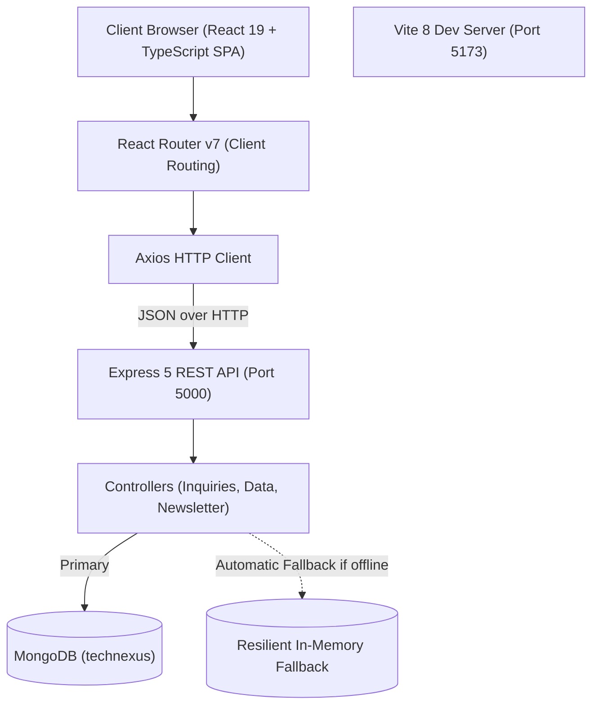

# Tech Nexus Systems — Enterprise IT Solutions Platform

> **Modern, High-Speed IT Solutions, QA Automation & AI Engineering Web Application**  
> Built with a high-performance **MERN + TypeScript** stack, featuring **React 19**, **Vite**, **Express 5**, and **MongoDB**.

---

## 📌 Table of Contents

- [Overview](#-overview)
- [System Architecture](#-system-architecture)
- [Technology Stack](#-technology-stack)
  - [Frontend Technologies & Libraries](#frontend-technologies--libraries)
  - [Backend Technologies & Libraries](#backend-technologies--libraries)
- [Dependencies Overview](#-dependencies-overview)
  - [Frontend Dependencies](#frontend-dependencies-packagejson)
  - [Backend Dependencies](#backend-dependencies-packagejson)
- [Project Directory Structure](#-project-directory-structure)
- [Backend API Reference](#-backend-api-reference)
  - [Core Endpoints](#core-endpoints)
  - [Sample Requests & Responses](#sample-requests--responses)
- [Database & Resilience Strategy](#-database--resilience-strategy)
- [Frontend Pages & Modules](#-frontend-pages--modules)
- [Interactive Canvas 3D Logo Generator](#-interactive-canvas-3d-logo-generator)
- [Environment Configuration](#-environment-configuration)
- [Getting Started & Installation](#-getting-started--installation)
  - [Prerequisites](#prerequisites)
  - [1. Backend Setup](#1-backend-setup)
  - [2. Frontend Setup](#2-frontend-setup)
- [Available Scripts](#-available-scripts)
- [Design System & Aesthetics](#-design-system--aesthetics)

---

## 🌟 Overview

**Tech Nexus Systems** is a modern full-stack web application designed for an enterprise technology agency specializing in:
- **QA Automation & Test Engineering** (Playwright, Cypress, CI/CD automated test suites)
- **Artificial Intelligence (AI) Solutions** (Enterprise AI Agents, RAG pipelines, LLM workflow automation)
- **Data Engineering & Analytics** (Automated ETL/ELT, Snowflake/BigQuery warehouses, real-time KPI dashboards)
- **DevOps & Cloud Infrastructure** (Docker, Kubernetes, Terraform, zero-downtime CI/CD)
- **Full-Stack Web & Software Engineering** (High-throughput Node.js/Express APIs, modern TypeScript React SPAs)
- **Cybersecurity & Compliance Audits** (SAST/DAST, OWASP protection, vulnerability management)

The application provides a public client experience with service catalog exploration, real-world case study presentations, dynamic technology radars, interactive quote request and consultation modals, newsletter subscriptions, and an animated Canvas-based logo video rendering tool.

---

## 🏗 System Architecture



---

## 💻 Technology Stack

### Frontend Technologies & Libraries
- **Language**: [TypeScript (~6.0)](https://www.typescriptlang.org/) — End-to-end type safety, typed interfaces for API contracts and domain models.
- **UI Framework**: [React 19 (v19.2.8)](https://react.dev/) — Latest React architecture utilizing state hooks, concurrent features, and modern component lifecycle.
- **Client Routing**: [React Router DOM (v7.18.4)](https://reactrouter.com/) — Single-Page Application routing (`/`, `/about`, `/services`, `/tech-stack`, `/case-studies`, `/contact`).
- **Build Tool & Bundler**: [Vite (v8.3.0)](https://vite.dev/) — Lightning-fast ES module Hot Module Replacement (HMR) and optimized rollup production bundles.
- **Icons**: [React Icons (v5.7.0)](https://react-icons.github.io/react-icons/) — Vector SVG icons from FontAwesome 6, Feather, Heroicons, and Lucide.
- **HTTP Client**: [Axios (v1.20.0)](https://axios-http.com/) — Typed HTTP requests with configurable base URLs, timeouts, and error interceptors.
- **Linter**: [Oxlint (v1.81.0)](https://oxc.rs/) — Next-generation ultra-fast Rust-based JavaScript/TypeScript linter.
- **Typography & Styling**: Vanilla CSS3 design system with custom CSS variables, Google Fonts (*Plus Jakarta Sans* & *Space Grotesk*), glassmorphic card stylings, and hardware-accelerated animations.

### Backend Technologies & Libraries
- **Runtime Environment**: [Node.js (v18+)](https://nodejs.org/) — Event-driven asynchronous JavaScript runtime.
- **Web Framework**: [Express 5 (v5.3.0)](https://expressjs.com/) — Fast, unopinionated minimalist web framework with modern promise-handling middleware.
- **Database & ODM**: [MongoDB & Mongoose (v9.11.1)](https://mongoosejs.com/) — Schematized document modeling, validation, pre-save middleware hooks, and automatic connection retries.
- **CORS Management**: [cors (v2.8.6)](https://www.npmjs.com/package/cors) — Cross-Origin Resource Sharing handling for local and production client URLs.
- **Environment Management**: [dotenv (v18.0.7)](https://www.npmjs.com/package/dotenv) — Zero-dependency configuration loader for `.env`.
- **Security & Tokens**: 
  - [bcryptjs (v3.0.3)](https://www.npmjs.com/package/bcryptjs) — Password hashing algorithms.
  - [jsonwebtoken (v9.0.3)](https://www.npmjs.com/package/jsonwebtoken) — JSON Web Token implementation.
- **Cookies & Parsing**: [cookie-parser (v1.4.7)](https://www.npmjs.com/package/cookie-parser) — Header cookie serialization.
- **Dev Live Reload**: [nodemon (v3.1.14)](https://nodemon.io/) — File-watching development server restarter.

---

## 📦 Dependencies Overview

### Frontend Dependencies (`Frontend/package.json`)

#### Production Dependencies
| Package | Version | Purpose |
| :--- | :--- | :--- |
| `react` | `^19.2.8` | Declarative UI component library |
| `react-dom` | `^19.2.8` | DOM renderer for React |
| `react-router-dom` | `^7.18.4` | Declarative routing & navigation |
| `react-icons` | `^5.7.0` | Comprehensive SVG icon library |
| `axios` | `^1.20.0` | Promise-based HTTP client for API calls |

#### Development Dependencies
| Package | Version | Purpose |
| :--- | :--- | :--- |
| `vite` | `^8.3.0` | Next-generation frontend tooling and bundler |
| `@vitejs/plugin-react` | `^6.1.1` | Fast Refresh using Oxc compiler |
| `typescript` | `~6.0.2` | Static type-checking system |
| `oxlint` | `^1.81.0` | Ultra-fast linter for TS/JS |
| `@types/react` | `^19.2.18` | Type declarations for React |
| `@types/react-dom` | `^19.2.7` | Type declarations for React DOM |
| `@types/node` | `^24.13.3` | Type declarations for Node.js APIs |

---

### Backend Dependencies (`Backend/package.json`)

#### Production Dependencies
| Package | Version | Purpose |
| :--- | :--- | :--- |
| `express` | `^5.3.0` | Web application framework and REST router |
| `mongoose` | `^9.11.1` | MongoDB object modeling and schema validation |
| `cors` | `^2.8.6` | Cross-Origin resource sharing middleware |
| `dotenv` | `^18.0.7` | Loads environment variables from `.env` file |
| `jsonwebtoken` | `^9.0.3` | Authentication and session token handling |
| `bcryptjs` | `^3.0.3` | Secure password and token hashing |
| `cookie-parser` | `^1.4.7` | Parses cookie headers into `req.cookies` |

#### Development Dependencies
| Package | Version | Purpose |
| :--- | :--- | :--- |
| `nodemon` | `^3.1.14` | Auto-restarts server process upon file modifications |

---

## 📁 Project Directory Structure

```text
Tech_Nexu/
├── README.md                           # Root repository documentation
├── Backend/                            # Node.js + Express + Mongoose Backend
│   ├── .env                            # Environment configuration (PORT, MONGODB_URI)
│   ├── package.json                    # Backend dependencies and scripts
│   └── src/
│       ├── config/
│       │   └── db.js                   # Mongoose connection with resilient fallback
│       ├── controllers/
│       │   ├── dataController.js       # Dynamic services, stats & case studies
│       │   └── inquiryController.js    # Inquiries, RFPs & newsletter subscriptions
│       ├── models/
│       │   ├── Inquiry.js              # Mongoose schema for client RFP inquiries
│       │   └── Newsletter.js           # Mongoose schema for email subscriptions
│       ├── routes/
│       │   └── api.js                  # Express API route declarations
│       └── server.js                   # Express app initialization, middleware & listener
│
├── Frontend/                           # React 19 + TypeScript + Vite SPA
│   ├── README.md                       # Frontend project documentation
│   ├── index.html                      # HTML5 root with SEO metadata & Google Fonts
│   ├── package.json                    # Frontend dependencies and scripts
│   ├── tsconfig.json                   # TypeScript project configuration
│   ├── vite.config.ts                  # Vite build and plugin configuration
│   ├── public/
│   │   ├── tech-nexus.html             # Canvas animated logo & video recorder tool
│   │   └── robots.txt
│   └── src/
│       ├── main.tsx                    # React application entrypoint
│       ├── App.tsx                     # Main layout, router & global consultation modal
│       ├── index.css                   # Global design tokens, gradients & styles
│       ├── components/
│       │   ├── Navbar.tsx              # Sticky top header navigation & mobile drawer
│       │   ├── Footer.tsx              # Footer with links & newsletter form
│       │   ├── HeroSection.tsx         # Modern hero banner with metrics & CTAs
│       │   ├── HomePage.tsx            # Assembled landing page
│       │   ├── ServicesGrid.tsx        # 6 core services showcase grid
│       │   ├── TechNexusLogo3D.tsx     # Canvas-based 3D node network logo
│       │   ├── TechRadar.tsx           # Interactive technology category radar
│       │   ├── WhyChooseUs.tsx         # Engineering differentiators & performance stats
│       │   ├── CaseStudiesSection.tsx  # Featured enterprise project showcases
│       │   ├── TestimonialsSection.tsx # Verified client reviews & ratings
│       │   ├── StatsRibbon.tsx         # High-level business impact numbers
│       │   ├── ConsultationModal.tsx   # Interactive popup modal for quick RFPs
│       │   └── ContactForm.tsx         # Full-featured RFP submission form
│       ├── data/
│       │   ├── servicesData.ts         # Service descriptions, tools & deliverables
│       │   ├── caseStudiesData.ts      # Client stories, architectures & metrics
│       │   ├── techStackData.ts        # Categorized technologies & tools data
│       │   └── faqData.ts              # Frequently asked questions dataset
│       ├── pages/
│       │   ├── AboutPage.tsx           # Company vision, engineering team & mission
│       │   ├── ServicesPage.tsx        # In-depth specialized engineering solutions
│       │   ├── TechStackPage.tsx       # Interactive technology ecosystem breakdown
│       │   ├── CaseStudiesPage.tsx     # Full client transformations and metrics
│       │   └── ContactPage.tsx         # Office locations, direct contacts & form
│       └── services/
│           └── api.ts                  # Axios API client functions with types
│
└── tech-nexus.html                     # Standalone Canvas logo video rendering tool
```

---

## 📡 Backend API Reference

Base URL: `http://localhost:5000/api`

### Core Endpoints

| Method | Endpoint | Description | Request Body | Response |
| :--- | :--- | :--- | :--- | :--- |
| `GET` | `/` | Root API Greeting & Status | None | JSON object with API status |
| `GET` | `/api/health` | Health Check | None | `{ status: "ok", service: "...", timestamp: "..." }` |
| `POST` | `/api/inquiries` | Submit Project Inquiry / RFP | JSON with `fullName`, `email`, `message`, etc. | Reference code, confirmation message, saved object |
| `GET` | `/api/inquiries` | Retrieve All Inquiries | None | List of recent inquiry records |
| `POST` | `/api/newsletter` | Subscribe to Tech Newsletter | `{ "email": "user@example.com" }` | Subscription status & message |
| `GET` | `/api/services` | Retrieve Engineering Services | None | Array of all 6 specialized IT services |
| `GET` | `/api/case-studies` | Retrieve Enterprise Case Studies | None | Array of case studies with metrics |
| `GET` | `/api/stats` | Retrieve Company Metrics | None | High-level statistics (clients, uptime, tests run) |

---

### Sample Requests & Responses

#### 1. Submit Inquiry (`POST /api/inquiries`)

**Request Payload:**
```json
{
  "fullName": "Sarah Jenkins",
  "email": "sarah.jenkins@enterprise.com",
  "phone": "+1 (555) 234-5678",
  "company": "Apex Fintech Inc.",
  "service": "QA Automation",
  "budget": "$10,000 - $25,000",
  "timeline": "1 - 3 Months",
  "message": "We need an automated regression suite with Playwright and CI/CD pipeline integration."
}
```

**Response (HTTP 201 Created):**
```json
{
  "success": true,
  "message": "Thank you! Your inquiry has been received. Our solutions team will contact you within 24 hours.",
  "referenceCode": "TN-4821-K9X2B1",
  "data": {
    "_id": "6710db4e81fa2c34918e98bc",
    "fullName": "Sarah Jenkins",
    "email": "sarah.jenkins@enterprise.com",
    "company": "Apex Fintech Inc.",
    "service": "QA Automation",
    "budget": "$10,000 - $25,000",
    "timeline": "1 - 3 Months",
    "message": "We need an automated regression suite with Playwright and CI/CD pipeline integration.",
    "status": "New",
    "referenceCode": "TN-4821-K9X2B1",
    "createdAt": "2026-10-16T11:15:32.184Z"
  }
}
```

#### 2. Subscribe to Newsletter (`POST /api/newsletter`)

**Request Payload:**
```json
{
  "email": "lead.architect@company.com"
}
```

**Response (HTTP 201 Created):**
```json
{
  "success": true,
  "message": "Thank you for subscribing! Stay tuned for TechNexus engineering insights."
}
```

---

## 🛡 Database & Resilience Strategy

The backend implements a **Dual-Mode Resilient Architecture**:
1. **Primary Store**: [MongoDB](https://www.mongodb.com/) via Mongoose. Automatically connects to `MONGODB_URI` specified in `Backend/.env`.
2. **Graceful In-Memory Fallback**: If a local MongoDB instance is not installed or unreachable, the server logs a notice:
   ```text
   [Database] MongoDB Connection notice: connect ECONNREFUSED 127.0.0.1:27017
   [Database] Running with in-memory resilient data store fallback.
   ```
   All API endpoints (`/api/inquiries`, `/api/newsletter`) seamlessly switch to an active in-memory data store without crashing or rejecting user submissions.

---

## 🖥 Frontend Pages & Modules

| Route | Page Component | Features & Purpose |
| :--- | :--- | :--- |
| `/` | `HomePage.tsx` | Hero banner, interactive 3D logo, service cards, why choose us, tech radar, case study preview, verified testimonials, and global CTA. |
| `/about` | `AboutPage.tsx` | Founding mission, engineering philosophy, core pillars, team values, and enterprise delivery guarantees. |
| `/services` | `ServicesPage.tsx` | Comprehensive breakdown of all 6 technical disciplines with feature checklists, technology badges, and metrics. |
| `/tech-stack` | `TechStackPage.tsx` | Interactive matrix of languages, frameworks, cloud platforms, QA automation tools, and databases. |
| `/case-studies` | `CaseStudiesPage.tsx` | In-depth case studies covering QA automation, AI knowledge search, high-volume data pipelines, and cloud migration. |
| `/contact` | `ContactPage.tsx` | Full RFP inquiry form with budget/timeline selectors, office locations, FAQ accordion, and direct contact options. |
| `*` | *(Navigate)* | Automatic redirect back to `/` for unknown URLs. |

---

## 🎥 Interactive Canvas 3D Logo Generator

Located at:
- `tech-nexus.html` (root directory)
- `Frontend/public/tech-nexus.html` (accessible via `http://localhost:5173/tech-nexus.html`)

### Features:
- **Real-Time Animation**: Renders the Tech Nexus geometric network node logo at 60 FPS using pure HTML5 Canvas.
- **Direct Video Export**: Uses the browser's native `MediaRecorder` API to capture and download a **1080x1080 high-definition 6-second `.webm` video** directly to your Downloads folder.
- **Controls**: Live preview toggle, render progress indicator, and instantaneous download trigger.

---

## ⚙ Environment Configuration

### Backend `.env` (`Backend/.env`)

```env
PORT=5000
MONGODB_URI=mongodb://127.0.0.1:27017/technexus
CLIENT_URL=http://localhost:5173
NODE_ENV=development
```

| Variable | Default Value | Description |
| :--- | :--- | :--- |
| `PORT` | `5000` | HTTP port on which the Express server listens |
| `MONGODB_URI` | `mongodb://127.0.0.1:27017/technexus` | MongoDB connection connection string |
| `CLIENT_URL` | `http://localhost:5173` | Allowed frontend client origin for CORS |
| `NODE_ENV` | `development` | Runtime environment (`development` or `production`) |

---

## 🚀 Getting Started & Installation

### Prerequisites
- **Node.js**: `v18.0.0` or higher
- **npm**: `v9.0.0` or higher
- *(Optional)* **MongoDB**: Local MongoDB daemon running on port `27017` (not mandatory due to built-in in-memory fallback).

---

### 1. Backend Setup

Open a terminal in `Backend/`:

```bash
cd Backend

# Install dependencies
npm install

# Start development server with nodemon
npm run dev
```

The backend server will start at:
- 🌐 **Base URL**: `http://localhost:5000`
- 🩺 **Health Check**: `http://localhost:5000/api/health`

---

### 2. Frontend Setup

Open a second terminal in `Frontend/`:

```bash
cd Frontend

# Install dependencies
npm install

# Start Vite development server
npm run dev
```

The frontend application will start at:
- 💻 **Web App**: `http://localhost:5173`
- 🎬 **Logo Generator**: `http://localhost:5173/tech-nexus.html`

---

## 📜 Available Scripts

### Frontend Scripts (`Frontend/`)
- `npm run dev`: Launches the Vite development server with Hot Module Replacement on port `5173`.
- `npm run build`: Type-checks code using `tsc -b` and compiles optimized production assets to `dist/`.
- `npm run preview`: Locally previews the production build output.
- `npm run lint`: Runs ultra-fast linting using `oxlint`.

### Backend Scripts (`Backend/`)
- `npm run dev`: Starts the Express server with `nodemon` for auto-restart on code changes.
- `npm start`: Starts the Express server in production mode with standard `node`.

---

## 🎨 Design System & Aesthetics

- **Color Palette**:
  - Primary Brand Blue: `#0b57d0` / `#0088ff`
  - Accent Electric Orange: `#e8845a` / `#ff6b3d`
  - Dark Navy Backgrounds: `#0b1220`, `#06283d`, `#0a1017`
  - Light Neutral Cards: `#ffffff`, `#f8fafd`
  - Border Accents: `rgba(11, 87, 208, 0.12)`
- **Typography**:
  - Headings: `Plus Jakarta Sans`, sans-serif (Weights: 600, 700, 800)
  - Display & Badges: `Space Grotesk`, monospace/sans (Weights: 500, 600)
  - Body: `Plus Jakarta Sans`, system-ui (Weights: 400, 500)
- **UI Elements**:
  - Gradient text fills (`.gradient-text-cyan`, `.gradient-text-blue`, `.gradient-text-orange`)
  - Subtle technical grid dot backgrounds (`.tech-grid-pattern`)
  - Elevated card hover micro-animations
  - Fully responsive breakpoints for mobile (`< 768px`), tablet (`< 1024px`), and desktop monitors.
